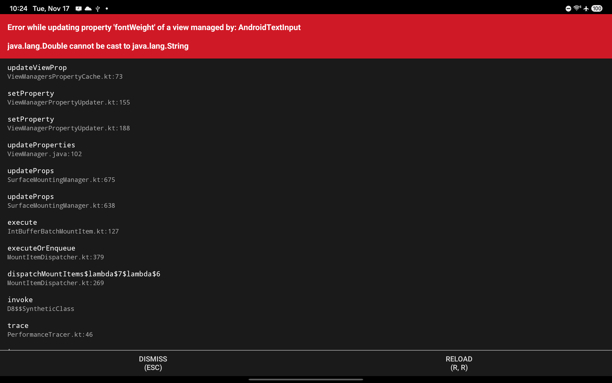

# Uniwind Pro Android TextInput theme reproduction

Minimal Expo app for an Android `fontWeight` type error when the system switches between light and dark themes. No HeroUI, navigation, application stores, or custom native code is involved.

## Requirements

- Node.js 22.19+ and pnpm 12.14.0.
- Android SDK/JDK configured for Expo native builds, and an Android device or emulator.
- A Uniwind Pro license and local authentication. Follow the [Pro installation guide](https://docs.uniwind.dev/pro). This repository contains no license, credentials, or Pro implementation code.
- A native development build; **Expo Go cannot run Uniwind Pro**.

## Run

```sh
pnpm install
pnpm android
```

If the Pro installer requests authentication, run `pnpm exec uniwind-pro`, authenticate with your own licensed account, then retry installation/build as directed by the installer.

## Reproduce

1. Launch the app in its default **font-normal repro** mode.
2. Wait for the input to appear and remain mounted. No typing or focus is required.
3. Open Android Quick Settings and switch the system Dark theme setting.
4. Return to the app without reloading it. Check the red error overlay and Metro/logcat output.

With one Android target connected, you can switch the same system setting through ADB instead:

```sh
adb shell cmd uimode night no
adb shell cmd uimode night yes
```

Record your original night-mode setting (`adb shell cmd uimode night`) and restore it after testing.

Expected: the input updates its colors without a native property error.

Reported error:

```text
Error while updating property 'fontWeight' of a view managed by: AndroidTextInput
java.lang.Double cannot be cast to java.lang.String
Caused by java.lang.ClassCastException: java.lang.Double cannot be cast to java.lang.String
  com.facebook.react.uimanager.ViewManagersPropertyCache$StringPropSetter.getValueOrDefault
```

## String-weight control

Reload the app if an error overlay is open. Before switching the system theme, tap **Switch to string-weight control**. This uses the same theme-dependent colors, but replaces `font-normal` with inline `style={{ fontWeight: '400' }}`. Switching modes remounts the input; changing the system theme does not.

The app deliberately does not call `useColorScheme()` or `useUniwind()`: theme changes exercise Pro's native style-update path rather than an application-triggered React rerender. Development-only Uniwind `reportUpdates` diagnostics expose the styles sent to native.

## Versions

| Dependency | Version |
| --- | --- |
| Uniwind Pro | 1.10.0 |
| React Native | 0.88.1 |
| Expo | 58.0.23 |
| React | 19.3.0 |
| Tailwind CSS | 4.3.5 |
| Nitro Modules | 0.37.2 |
| Reanimated | 4.7.1 |
| Worklets | 0.13.0 |

Direct dependencies are pinned; `pnpm-lock.yaml` pins transitive dependencies. Generated native projects and installed packages are not committed.

## Latest verification (1.10.0)

Upgraded to Uniwind Pro **1.10.0**, regenerated the lockfile, rebuilt the Android native app (including Uniwind C++), and cleared Metro's cache. All other direct dependency versions and the reproduction code are unchanged.

Verified again on the physical Samsung SM-X518U, Android 16 / API 36:

- Default `font-normal` mode mounted successfully in dark mode.
- Switching dark → light with `adb shell cmd uimode night no` still produced the exact `AndroidTextInput` exception. Diagnostics sent numeric `fontWeight: 400`.
- After relaunching into the string-weight control, switching light → dark succeeded. Diagnostics sent `fontWeight: '400'`, the input remained mounted, and the new process's logcat had no weight-cast failure.
- Restored the original dark-mode setting. iOS and Web were not tested.


Upstream report: https://github.com/uni-stack/uniwind/issues/774

## Original device result (1.9.0)

Verified on a physical Samsung SM-X518U running Android 16 (API 36), with an arm64 Fabric debug build:

- Initial render in dark mode succeeded.
- `adb shell cmd uimode night no` produced the exact native exception above.
- Uniwind diagnostics identified the affected `TextInput (22)` and sent numeric `fontWeight: 400`.
- After relaunching and selecting the string-weight control, `adb shell cmd uimode night yes` updated the colors successfully. Diagnostics sent `fontWeight: '400'`, and the new process's logcat contained no weight-cast failure.
- The original system dark-mode setting was restored. iOS and Web were not tested.



Diagnostic excerpts (unrelated style properties omitted):

```text
Repro — C++ shadow-tree update:
  'TextInput (22)', { ... fontWeight: 400, ... color: '#111827' }

Control — C++ shadow-tree update:
  'TextInput (48)', { ... fontWeight: '400', ... color: '#F9FAFB' }
```

The verification build used JDK 21:

```sh
pnpm exec expo prebuild --platform android --no-install
./android/gradlew -p android :app:assembleDebug \
  -PreactNativeArchitectures=arm64-v8a \
  -PreactNativeDevServerPort=8082
pnpm start --port 8082 --localhost
adb reverse tcp:8082 tcp:8082
```

The resulting debug APK was installed and launched on the device. Port 8082 was used only to avoid another local Metro server; `pnpm android` uses the normal Expo flow.

`index.js` imports Reanimated before the app to avoid a separate initialization cycle between Reanimated's performance monitor and Uniwind's TextInput wrapper on these versions. No dependency source patches are used.
